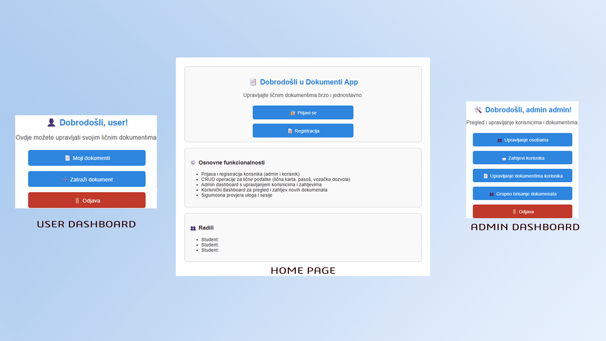

# 🗂️ Personal Document Management App

Welcome to the repository for the **Personal Document Management App**! 🧾📁
This application offers a straightforward and secure solution for managing users’ documents via an intuitive web interface. It is built as a **full-stack PHP application** with implemented **CRUD functionalities** (Create, Read, Update, Delete).

## 🔧 Technologies Used:
* **PHP** – for backend logic and data handling
* **HTML5** – for page structure
* **CSS3** – for styling the user interface
* **JavaScript** – for interactive features
* **MySQL** – relational database for storing user and document data
* **XAMPP** – local server package (Apache + MySQL)
* **VS Code** – primary code editor used during development
 
## 🧠 Features
The app allows both users and administrators to manage personal documents efficiently. Key features include:
* 🔐 **User and Admin Panels** – separate interfaces with different access privileges
* ➕ **Add Documents** – input new personal documents (e.g., ID card, passport, driver’s license...)
* 📋 **View and Search** – dynamic table with filtering and multi-criteria search
* 🛠️ **Edit Records** – update existing document information
* ❌ **Delete Records** – securely remove expired or unnecessary data
* 🗃️ **Relational Database** – structured connection between users, document types, and change history

## 🗂️ Database Structure

The database is designed to support:
* User registration and tracking
* Document categorization
* Monitoring issue/expiry dates and additional metadata
* Logical consistency and referential integrity through primary and foreign keys

## 📸 Application Screenshot
 

## 🔗 Video demonstration
🎥 

## ✉️ Contact

Feel free to reach out for feedback, questions, or suggestions!
*📧 Email: [Email for inquiries](nurkiceldin1@gmail.com)
*📱 Instagram: [Instagram link for inquiries](instagram.com/nurkiceldin)
*💼 LinkedIn: [LibkedIn profile](https://www.linkedin.com/in/eldin-nurkic-2b195a1a9/)

## ⭐ Feedback

If you like the project, feel free to leave a ⭐ on the repository!
Your feedback helps me improve and grow as a developer. Thank you! 🙌
